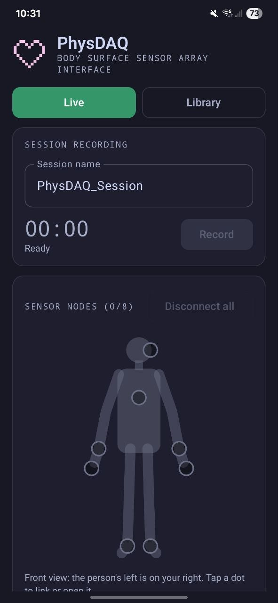
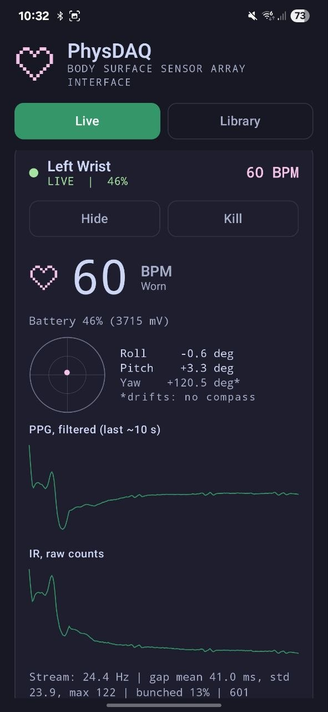

# PhysDAQ for Android

A phone app that records from PhysDAQ devices over Bluetooth, with no laptop,
desktop app or Python bridge in between. Link each device to a body position,
press Record, and get one CSV per device that `analysis/pipeline.py` reads as is.

- Live heart rate, tilt and signal plots for every linked device
- A body map and eight positions, as on the desktop app
- A Library of every session on the phone, with per-node statistics, charts and
  a side-by-side heart-rate comparison
- Opens desktop-app CSVs too

<p align="center">
  
  &nbsp;&nbsp;
  
</p>
<p align="center"><sub>Left: the Live tab with nothing linked yet. Right: a sensor on the left wrist, worn, at 60 BPM.</sub></p>

How it works, file formats and limits: **[docs/android-app.md](../docs/android-app.md)**.
How to record a session: **[User Guide](../docs/user-guide.md#recording-with-the-phone-app)**.

> Research instrument, not a medical device. No claim of clinical accuracy.

---

## Install from an APK (no Android Studio)

1. On the phone, open this repository's
   [Releases page](../../../releases) and download
   **`PhysDAQ-Android-<version>.apk`**.
2. Open the downloaded file. Android asks to allow installing apps from your
   browser or Files app: allow it for that app.
3. If Play Protect warns about an unknown developer, choose **Install anyway**.
   The APK is signed by the project, not published on the Play Store.
4. On first use, allow **Nearby devices** and **notifications**.

Installing a newer APK over an older one keeps your recordings and body-position
assignments. A copy installed from Android Studio is signed differently, so
uninstall it first; recordings stay in `Download/PhysDAQ/` but the Library then lists
only new ones (open older ones with **Open CSV file**).

---

## Build and install from source

1. Install [Android Studio](https://developer.android.com/studio) and open this
   `android/` folder (not the repo root).
2. Let Gradle sync finish.
3. On the phone, enable Developer options and USB debugging. Plug it in.
4. Press **Run ▶**. The app is called **PhysDAQ**.
5. On first use, allow **Nearby devices** (Bluetooth) and **notifications** (the
   notification keeps recording alive with the screen off).

Requires Android 10 (API 29) or newer. Tested on a Samsung Galaxy S22.

From a terminal:

```bash
./gradlew assembleDebug    # debug APK, for your own phone   (Windows PowerShell: .\gradlew assembleDebug)
./gradlew assembleRelease  # signed release APK, once the release key is set up
./gradlew test             # run the unit tests, no phone needed
```

If the editor shows hundreds of red "Unresolved reference" errors but
`gradlew assembleDebug` succeeds, the code is fine: use *File → Sync Project with
Gradle Files*, then *File → Invalidate Caches → Invalidate and Restart*. Keeping the
project inside OneDrive makes this more likely; see
[development.md](../docs/development.md#android-app).

Making a release APK (signing key, CI): see
[development.md](../docs/development.md#android-release-apk).

---

## Where recordings go

`Download/PhysDAQ/` on the phone, one file per device:

```
2026-10-22_12-17-44_PhysDAQ_Session_finger-left.csv
```

Copy them to a computer over USB (File transfer mode), then:

```bash
make process FILE=path/to/that.csv
```

---

## Layout

```
android/
├── app/src/main/java/com/physdaq/mobile/
│   ├── ble/        Bluetooth: scanner, connection, line parser, reconnect, stream stats
│   ├── dsp/        heart rate, waveform filter, tilt (Madgwick)
│   ├── storage/    file names, CSV writer, MediaStore output, recorders
│   ├── nodes/      body positions, their storage, sleep hint, pre-record check, body map layout
│   ├── library/    CSV analysis, session grouping, node comparison, Library screen
│   ├── ui/         live chart, tilt indicator, body map, theme
│   └── *.kt        AcquisitionRuntime, AcquisitionService, DeviceSession, MainActivity
├── app/src/test/   JVM unit tests (+ a real recording excerpt in resources/)
└── tools/          Python helpers, see tools/README.md
```
